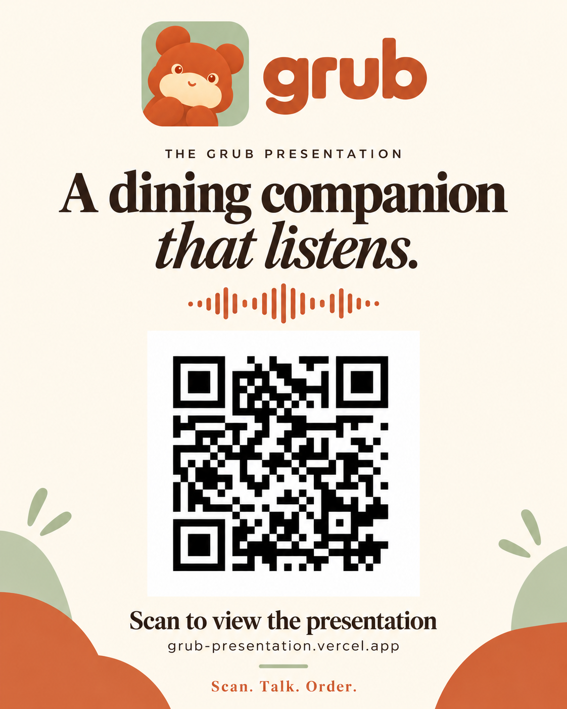

# QR Ordering Agent

Paste a restaurant's website, get a QR code. Diners scan it and order by chatting (or talking) to an agent that remembers their preferences across every restaurant.

Tickets: https://github.com/tanveerriaz/sg-opus-dev-day/issues · Menu format: [docs/menu-format.md](docs/menu-format.md)

## Grub presentation

[**Open the Grub presentation**](https://grub-presentation.vercel.app/) — press **F** for fullscreen and use the arrow keys to move between slides.

Scan the QR code below or click the card to open the presentation.

<a href="https://grub-presentation.vercel.app/">
  
</a>

## Setup

1. Install dependencies:

   ```bash
   npm ci
   ```

2. Create a Supabase project, open its **SQL editor**, and run the files in `supabase/migrations/` in order (`0001_init.sql`, then `0002_orders_served_at.sql`).

3. Copy `.env.example` to `.env.local` and fill in `SUPABASE_URL` and `SUPABASE_SERVICE_ROLE_KEY` (Supabase → Project Settings → API).

4. Load the seed restaurant:

   ```bash
   npm run seed
   ```

5. Run it locally and open http://localhost:3000/r/kopi-satay-house?mode=table&t=12:

   ```bash
   npm run dev
   ```

   Without the Supabase env vars, the app still serves the seed restaurant from `src/data/seed-restaurant.json`, so the UI can be worked on before Supabase is set up.

6. The kitchen screen for a restaurant is at http://localhost:3000/r/kopi-satay-house/dashboard. It checks for new orders every 2 seconds. Without Supabase it shows a few sample orders that live in memory.

## Deploy

Phones need a public HTTPS URL to scan, so deploy early.

**Production:** https://sg-opus-dev-day.vercel.app

**Table 12:** https://sg-opus-dev-day.vercel.app/r/kopi-satay-house?mode=table&t=12

The current deployment uses Vercel project `sg-opus-dev-day` under `priyadharshan-kannans-projects`, connected to Supabase project `opus5.5-build-day`. Both Supabase environment variables are configured for production only; the service-role key is stored as a Vercel secret.

Git integration could not connect to the repository. Releases are currently manual from this folder:

```bash
npx vercel@54.0.0 deploy --prod --scope priyadharshan-kannans-projects
```

The initial production release is commit `23b1267` from PR #7. Merging or pushing commits does not currently trigger a deployment.

### Setup for another environment

1. Push this folder to the GitHub repo.
2. In Vercel, **Add New → Project**, import the repo, and add the same env vars as `.env.local`.
3. Open `https://<your-app>.vercel.app/r/kopi-satay-house?mode=table&t=12` on a phone.

## Acceptance checks for issue #1

Use Node.js 22 or later. The committed lockfile makes dependency installation reproducible.

```bash
npm run check:menu
npm run build
npm run check:db
```

`check:db` reads `.env.local` if present, or credentials already set in the environment. It checks that all three tables are accessible and the stored restaurant matches the seed. It never writes data. Missing configuration fails the check; the local JSON fallback does **not** satisfy the Supabase acceptance criterion.

Start the production server with `npm start`, then run:

```bash
npm run check:smoke -- http://localhost:3000
```

After deploying, run the same command with the public HTTPS origin. It checks the full seed menu, allergen wording, table/pickup/delivery context, default context, and an unknown restaurant's 404 response. Deployment protection must allow unauthenticated access to the production diner link.

Before marking issue #1 complete, open the production table-12 link on a physical phone and confirm the menu and table number render. A desktop browser at mobile width is a useful layout check, but does not satisfy that final acceptance step.

### Verification on 13 October 2026

- Production build and TypeScript validation: passed.
- Seed contract: passed, 11 items including peanuts.
- Local production HTTP checks: passed for all five URL contexts and unknown restaurant.
- 390px browser viewport: all 11 items present, no horizontal overflow.
- Dependency audit after PostCSS patch: zero reported vulnerabilities.
- Supabase: initial schema applied through the SQL editor; all three tables exist with RLS enabled. Stored seed has 11 items, including three tagged with peanuts.
- Production: Vercel deployment `dpl_9mxZrBWChx1yiVbqppz12rrPLA4F` is READY with the production database settings. Public HTTPS smoke checks pass for all five URL contexts and the missing-restaurant 404.
- Physical-phone check: user confirmed the production restaurant name, Table 12 and menu work on a real phone on 13 October 2026. All five issue #1 acceptance criteria are verified.

## Restaurant onboarding (issue #3)

Open `/restaurant`. Choose **Website URL** or **Upload menu photos**. Photo uploads accept 1–8 JPG, PNG or WebP files, up to 3 MB combined; export HEIC as JPG first. Photos go to OpenAI for extraction; only the resulting menu is stored, with no uploaded photo URLs. Production requires Supabase plus a server-only `OPENAI_API_KEY`. Optional `OPENAI_EXTRACT_MODEL` defaults to `gpt-4.1`; optional `JINA_API_KEY` increases reader limits.

Website scrapes use Jina Reader and OpenAI vision, preserve the shared menu contract, and save successful results to `restaurants`. Repeat scrapes keep the restaurant ID. A cached URL falls back to its saved menu on a live failure or after about 20 seconds, including time spent on database calls. First-time scrapes and uploads have a 55-second budget. Uploads create a new restaurant each time. Production refuses to report success without persistent storage; local development may use memory.

The QR defaults to dine-in/Table 1. Change the table or select pickup/delivery before downloading. Use the public HTTPS app when generating phone QR codes, not localhost.

```bash
npm run check:scrape             # deterministic provider/timeout/upload regressions
npm run check:menu
npm run build
npm run check:smoke -- https://sg-opus-dev-day.vercel.app
# Explicit live opt-in: billable extraction, saves a test restaurant with four dishes.
node scripts/check-scrape-live.mjs https://sg-opus-dev-day.vercel.app
# Or verify a real restaurant website:
node scripts/check-scrape-live.mjs https://sg-opus-dev-day.vercel.app https://www.pastamania.com.sg/menu
```

Demo URLs: `https://www.pastamania.com.sg/menu` (image-based menu) and `https://www.lanonna.sg/menu` (text and photos). Menus and prices extracted by AI should be checked by the owner before real ordering. See `docs/verification/issue-3.md` for the tested scope and results.
