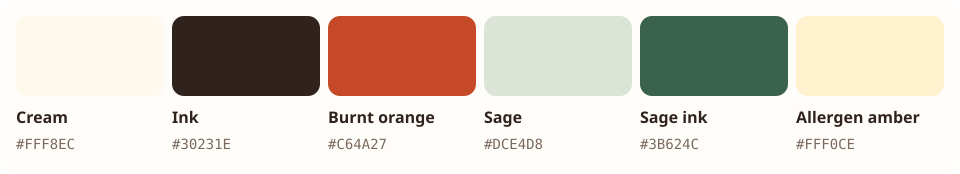

# Grub app design system




Grub is a warm, practical dining companion. Help diners read a real menu, understand preferences and build an order without hiding prices or restaurant context. This is the design specification for the app, written for humans, Codex, Claude and other coding tools. It documents the approved direction; it does not change the app implementation.

Approved by the user on 13 October 2026: use the existing A1 bear and the presentation's cream, orange and sage direction. Extend this system before introducing another visual language.

## Source of truth

- Approved brand asset: [assets/grub-bear.png](assets/grub-bear.png) — the original A1 image, unchanged.
- Colour reference: [palette.svg](palette.svg).
- Product contracts: [`src/lib/menu.ts`](../../src/lib/menu.ts), [`docs/menu-format.md`](../menu-format.md), [`GLOSSARY.md`](../../GLOSSARY.md).
- Presentation: https://grub-presentation.vercel.app/ (concept screens are labelled; not every depicted feature is released).

**Documentation only:** the proposed tokens, shared logo component and control classes below are specifications for future app work. They are not installed by this document. When implementation is requested, establish one shared token source in the existing global stylesheet and one reusable brand component; do not create competing styles in each screen.

## Palette

The core palette below is copied exactly from the presentation: cream, warm white, paper, ink, muted brown, line, orange, sage and green. Hover, stronger control borders, warning and error colours are functional app additions. Do not alter the original bear image to match UI tokens.

| Token / utility | Value | Purpose |
| --- | --- | --- |
| canvas | #FFF8EC | Original presentation cream |
| surface | #FFFDFA | Original warm white; inputs, order sheets and tickets |
| soft | #F5EDDF | Secondary surfaces and inactive controls |
| ink | #30231E | Main text |
| muted | #7A6A5D | Secondary text, readable on cream and white |
| line | #D9CBBB | Dividers and non-interactive card borders |
| control | #9B8270 | Input and secondary-button boundaries |
| action | #C64A27 | Original presentation orange; primary actions and wordmark |
| action-hover | #A9431E | Hover/pressed primary action |
| on-action | #FFFDFA | Text on primary action |
| sage | #DCE4D8 | Original presentation sage; dietary/success background |
| sage-ink | #3B624C | Original presentation green; dietary/success text |
| warning | #FFF0CE | Allergen and attention background |
| warning-ink | #78400E | Allergen and attention text |
| danger | #FBE5DE | Error background |
| danger-ink | #9D2F22 | Error text |

Use orange for actions, sage for supportive information and amber for allergens. Never communicate meaning through colour alone: retain visible labels. Orange action text on cream and white, white on action, and the semantic text/background pairs meet WCAG AA for normal text. Recheck contrast whenever colours change.

## Logo and naming

The product name is **Grub**. Restaurant names remain the main heading on restaurant pages; Grub identifies the companion, not the venue.

When implementing, create one reusable `<Brand />` that links home and shows the exact A1 image beside the Grub wordmark. Mount it once in the shared root layout. The image is decorative when the adjacent text supplies the name. Never replace it with an emoji, a generated variation or a CSS approximation. Keep the image square and uncropped, with at least 8px clear space; use 44px in the app header. Metadata uses the same bear icon.

## Type, spacing and shape

- Use the system sans stack for the working app: familiar, fast and legible. The presentation may use editorial serif emphasis; do not apply that to prices or form controls.
- Body: 16px / 1.5. Supporting copy: 14px. Small metadata/tags: 12px minimum. Page headings: 24–32px, weight 700. Restaurant headings: 20px.
- Use tabular numerals for prices, quantities, timestamps and totals. Keep amounts on one line; allow dish names and descriptions to wrap.
- Spacing follows the existing 4px Tailwind scale: 4, 8, 12, 16, 24, 32, 48px. Page gutters are 16px mobile / 24px for forms.
- Diner and onboarding content use `max-w-md`; kitchen uses `max-w-xl`. Fit 320px phones without horizontal page scrolling.
- Controls: 12px radius, at least 44px high. Cards/sheets: 16px radius. Pills are for short tags or status only.
- Prefer simple dividers in menus. Avoid wrapping every row in a card or adding decorative shadows.

## Shared controls and states

The proposed `grub-button` style should provide primary-action colour, height, radius, spacing, hover and disabled treatment. Use native buttons for actions and links for navigation; add it to either as appropriate. Give the main action a specific label, e.g. “Get QR” or “Confirm order”. Inputs retain visible labels or accessible names and stronger `control` borders.

Focus: 3px sage-ink outline with a 3px offset on links and controls. Do not remove focus rings. Disabled controls remain labelled and use the native disabled attribute. Pending actions explain the work (“Reading…”), prevent duplicate submission and retain surrounding context. Errors explain recovery and use `role="alert"`; keep user input available. Empty kitchen and basket views explain what happens next.

Use subtle 160ms colour transitions. Respect reduced motion; never auto-animate the logo or continuously pulse decoration. A microphone must never appear to be listening unless a real session is active.

## Feature patterns

### Menu and recommendations

Always show venue/table context, dish name, menu price, description, dietary labels and supplied allergen wording. Vegetarian and chicken are distinct options; do not imply chicken is vegetarian. Menu tags are source information, not certification. Never say “allergy-safe” solely because an allergen is absent from extracted data. An AI-extracted menu needs owner review before real ordering.

Recommendations explain why a dish is relevant without inventing profile history. Future recommendation cards reuse the menu typography and price treatment. Display actual menu content; do not add fake food photography or hard-coded example prices to production.

### Conversation and voice (open PRs)

Keep the venue, conversation state and basket count discoverable. Desktop can show recommendations, conversation and basket together; on phones use clear Menu / Chat / Cart navigation with persistent basket total and an accessible review sheet. Show transcripts alongside voice. Provide an explicit end-voice control and typing fallback; ending voice must preserve the basket. Existing PRs need to adopt these tokens when merged.

### Basket and confirmation (open PR)

Show line quantities, prices, notes and total. The diner explicitly confirms before saving an order. Payment is at the counter in the current scope. Keep the review dialog keyboard accessible, move focus inside it, return focus on closing and prevent background interaction.

### Restaurant setup and kitchen

Keep website/photo choice and progress understandable. QR images require a white quiet zone: never recolour or cover the functional code with the bear. On the kitchen screen preserve order source, table, quantities, notes, freshness and served state. Do not expose diner profile data in tickets.

## Coding-tool checklist

1. Read this document and the repository’s existing agent/project guidance before changing UI.
2. Implement or reuse one shared Brand and semantic token source. Avoid duplicate headers and raw palette values.
3. Preserve menu types, validation, server-only secrets, actual prices and existing behaviours.
4. Keep planned functionality and demo illustrations clearly labelled. A merged PR is not proof of a production release.
5. Run `npm run build`; for menu/route changes run the existing menu and smoke checks. Inspect mobile/desktop overflow, focus, asset loading and modified states.
6. Update this contract when a deliberate design decision changes. Avoid adding another component library for a small feature.

## Token implementation reference

For a future Tailwind v4 app update, copy this into the existing global stylesheet and use the corresponding semantic utilities. Keep this document and the implemented values in sync.

```css
@theme {
  --color-canvas: #fff8ec;
  --color-surface: #fffdfa;
  --color-soft: #f5eddf;
  --color-ink: #30231e;
  --color-muted: #7a6a5d;
  --color-line: #d9cbbb;
  --color-control: #9b8270;
  --color-action: #c64a27;
  --color-action-hover: #a9431e;
  --color-on-action: #fffdfa;
  --color-sage: #dce4d8;
  --color-sage-ink: #3b624c;
  --color-warning: #fff0ce;
  --color-warning-ink: #78400e;
  --color-danger: #fbe5de;
  --color-danger-ink: #9d2f22;
}
```

## Implementation examples

These are implementation examples for a later app change. Define the semantic tokens and `grub-button` before using them; these classes are not present in the current app. Avoid copying hex values into JSX:

```tsx
<button className="grub-button" disabled={saving}>
  {saving ? "Saving…" : "Confirm order"}
</button>

<p className="text-sm text-muted">Prices are shown in SGD.</p>
<span className="rounded-full bg-sage px-2 py-0.5 text-xs text-sage-ink">
  vegetarian
</span>
<span className="rounded-full bg-warning px-2 py-0.5 text-xs text-warning-ink">
  may contain: peanuts
</span>
```

After adding `<Brand />` to the root layout, do not duplicate it inside individual pages. Use actual menu values and state in production; the snippets illustrate styling only.
